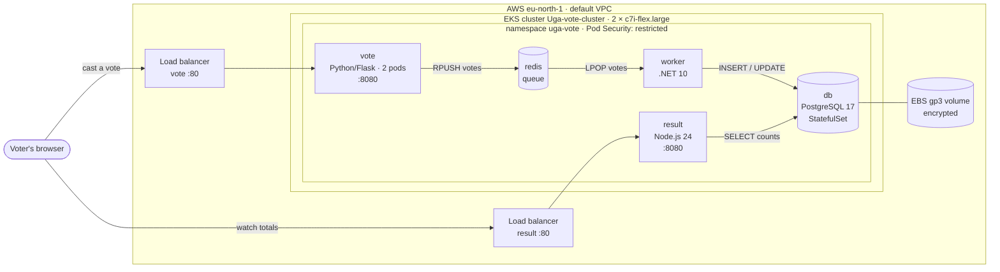
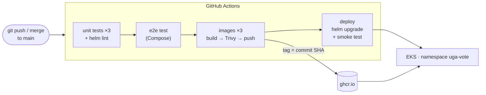
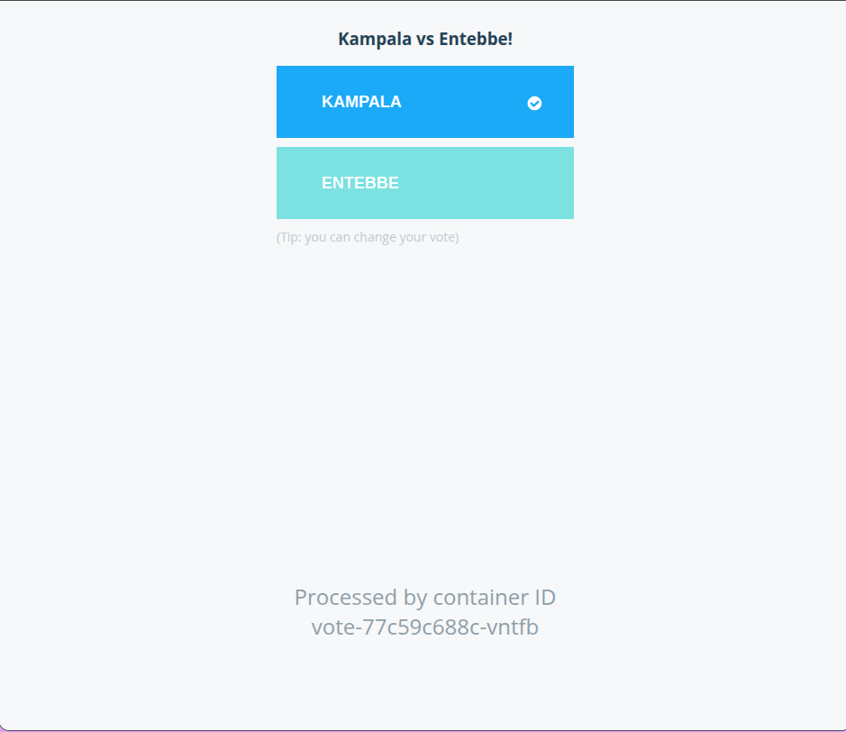
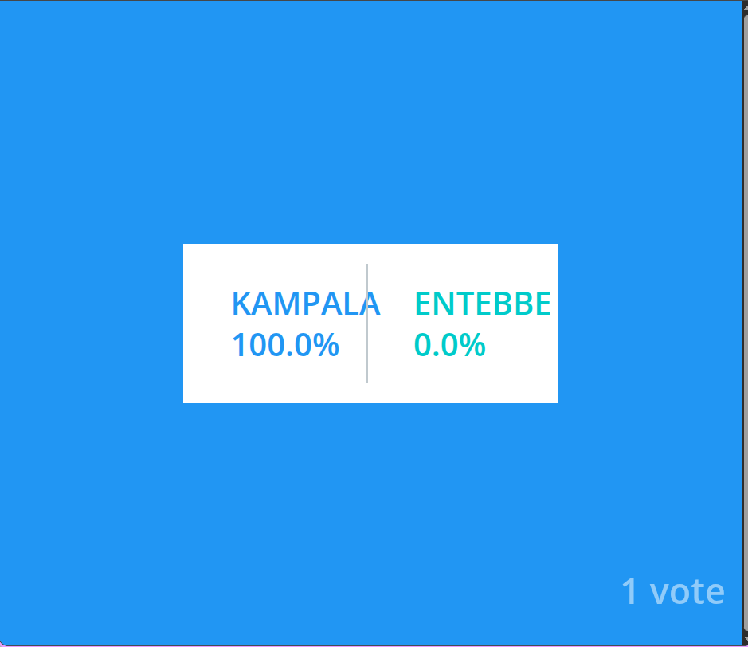
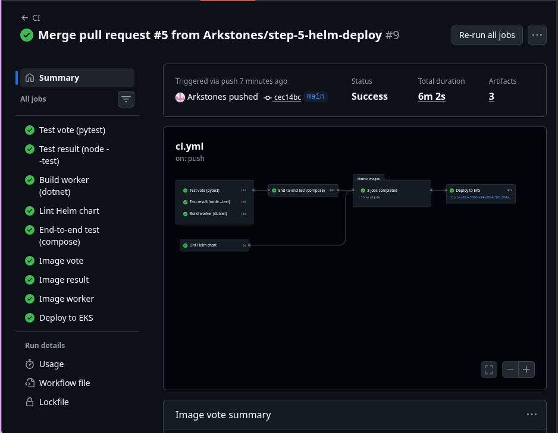
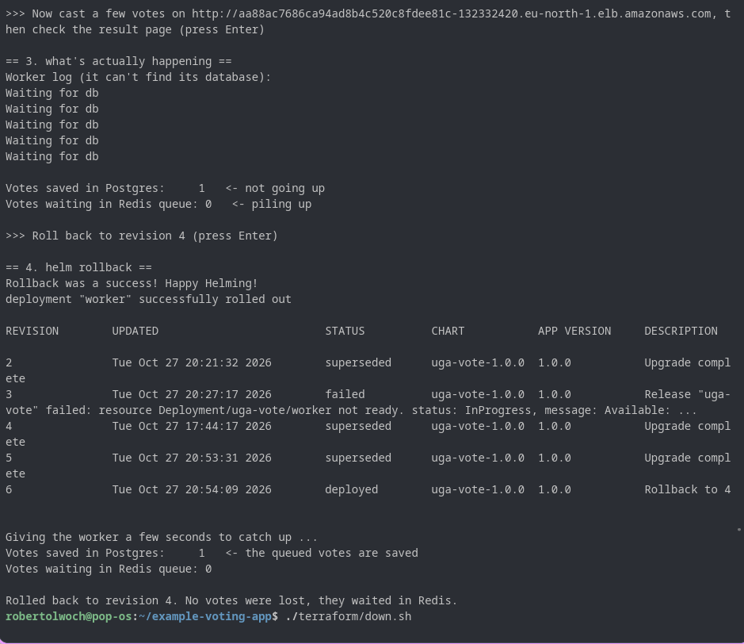

# Kampala vs Entebbe: shipping a voting app to AWS

**DevOps Capstone 1 ("Ship It")** · Robert Olwoch · fork of [dockersamples/example-voting-app](https://github.com/dockersamples/example-voting-app)

[](https://github.com/Arkstones/example-voting-app/actions/workflows/ci.yml)

A five-service voting app, taken from "runs on my laptop" to "every push to `main` is tested, scanned, built and deployed to Kubernetes on AWS", with a rollback I can show live.

People vote **Kampala** or **Entebbe**; the results page updates live.

| Done means… | How this repo does it |
|---|---|
| One push builds, scans and deploys | `.github/workflows/ci.yml`: tests → Trivy → push to ghcr.io → `helm upgrade` on EKS |
| The environment rebuilds from code | `terraform/up.sh` / `terraform/down.sh` create and destroy the whole cluster |
| No secrets in Git | Passwords and keys live only in GitHub secrets, a local `.env`, or Kubernetes Secrets |
| Rollback is shown live | `scripts/rollback-demo.sh` ships a bad release and rolls it back with `helm rollback` |

## Architecture





More detail, including what creates what: [docs/architecture.md](docs/architecture.md).

## Repository layout

```
vote/           Python/Flask voting page        + pytest tests
result/         Node.js live results page       + node --test tests
worker/         .NET 10 worker (Redis -> Postgres)
docker-compose.yml       local development
docker-compose.e2e.yml   end-to-end test with the production images
terraform/      EKS cluster in the default VPC  (up.sh / down.sh)
terraform/ci-user/       limited IAM user for the GitHub deploy job
k8s/cluster-setup.yaml   namespace (restricted pod security) + gp3 storage class
helm/uga-vote/  the Helm chart, one values.yaml
scripts/        e2e-test.sh, rollback-demo.sh, pin-image-digests.sh
.github/        CI/CD workflow and Dependabot
docs/           architecture diagrams
```

## Step 1: Run it locally

```bash
cp .env.example .env        # then set a long POSTGRES_PASSWORD in .env
docker compose up --build
```

- Vote: http://localhost:8080
- Results: http://localhost:8081

`.env` is in `.gitignore`. Compose refuses to start without `POSTGRES_PASSWORD`, so there's no default password to forget about.

## Step 2: Containerize it safely

| Service | Base image (pinned to a sha256 digest) | Runs as | Port |
|---|---|---|---|
| vote | `python:3.13-slim-trixie` | `app` (uid 10001) | 8080 |
| result | `node:24-trixie-slim` | `node` (uid 1000) | 8080 |
| worker | `mcr.microsoft.com/dotnet/runtime:10.0` | `app` (uid 1654) | — |
| redis | `redis:7.4-alpine` | `redis` (uid 999) | 6379 |
| db | `postgres:17-alpine` | `postgres` (uid 70) | 5432 |

- **Pinned images.** Every `FROM` line and image ends in `@sha256:…`, so a rebuild can't silently pick up different bytes. `scripts/pin-image-digests.sh` does the pinning, and Dependabot proposes updates.
- **Non-root.** That is why the apps listen on **8080**: on Linux, only root can bind to ports below 1024. Kubernetes maps port 80 back to 8080 on the load balancer.
- **Upgraded runtimes.** The upstream images used .NET 7 and Node 18, which are both end-of-life. They're now .NET 10 LTS and Node 24 LTS. Npgsql went from 4.1.9 (which has a SQL-injection CVE) to 10.0.3.
- **Small final images.** Multi-stage builds, and `pip`/`npm` are deleted from the final images (see the Trivy note below).
- **`.dockerignore` in every service.**
- **No hardcoded password.** The upstream code had `Password=postgres` in two places. Both apps now read `DB_*` environment variables.

## Step 3: Kubernetes cluster with Terraform

```bash
./terraform/up.sh      # ~15 min: cluster, nodes, add-ons, namespace, storage class
./terraform/down.sh    # deletes app namespaces (load balancers, disks) then destroys everything
```

- EKS (Kubernetes 1.36) in the **default VPC** of `eu-north-1`, using the `terraform-aws-modules/eks` module.
- 2 × `c7i-flex.large` nodes, which are allowed on the AWS free plan (see Problems below).
- Add-ons: VPC CNI, CoreDNS, kube-proxy, Pod Identity agent, EBS CSI driver (with its own IAM role).
- `upgrade_policy = STANDARD`, so the control plane can never slip into extended-support pricing.

I destroyed and recreated the cluster from code during the project. Details and design choices are in [terraform/README.md](terraform/README.md).

## Step 4: GitHub Actions

Every push and pull request runs `.github/workflows/ci.yml`:

1. **Unit tests.** 5 pytest tests for `vote` (Redis replaced by fakeredis), 7 `node --test` tests for `result`, a compile check for `worker`, and `helm lint` for the chart.
2. **End-to-end test.** `scripts/e2e-test.sh` starts all five services from the production image stages, casts a vote, and checks it reaches Postgres.
3. **Images.** Each one is built, then **scanned with Trivy**. The run fails on CRITICAL or HIGH vulnerabilities that have a fix. On `main`, images are pushed to `ghcr.io/arkstones/uga-vote/<service>:<commit SHA>`.
4. **Deploy** (main only). See Step 5.

Other choices:
- All third-party actions are **pinned to commit SHAs**, so a moved or hijacked tag can't change what runs.
- Workflow permissions are read-only, except `packages: write` for pushing images.

## Step 5: Deploy and roll back with Helm

The chart lives in `helm/uga-vote/`, with **one values file**.

- `vote` (2 replicas) and `result` sit behind AWS load balancers. `worker`, `redis` and `db` are internal only.
- Postgres is a StatefulSet on an encrypted gp3 EBS volume.
- The DB password comes from `--set db.password`, never from Git. The chart refuses to install without it or without `image.tag`.
- Every pod passes the **restricted** Pod Security Standard, which the namespace enforces.
- Probes, resource requests and limits are set for every pod.

**Deploying.** The pipeline's `deploy` job logs in as `github-deployer`, a limited IAM user that can only edit the `uga-vote` namespace. It runs:

```bash
helm upgrade --install uga-vote helm/uga-vote -n uga-vote \
  --set-string image.tag=<commit SHA> --set-string db.password=<from GitHub secret> --wait
```

It then waits until the public vote page answers.

**The rollback demo:**

```bash
./scripts/rollback-demo.sh
```

1. It ships a bad release: the worker is pointed at a database host that doesn't exist (`db-typo`).
2. Every pod still says `Running`, and both pages load. Nothing *looks* wrong.
3. But votes stop being counted. The script shows Postgres staying flat while the Redis queue grows.
4. `helm rollback` restores the previous revision. The worker reconnects and saves the queued votes, so none are lost.

## Secrets

| Secret | Where it lives |
|---|---|
| Local DB password | `.env` (git-ignored); `.env.example` has a placeholder |
| Cluster DB password | GitHub secret `POSTGRES_PASSWORD` → Helm → Kubernetes Secret `db-credentials` |
| Deploy credentials | GitHub secrets `AWS_ACCESS_KEY_ID` / `AWS_SECRET_ACCESS_KEY` for `github-deployer` (created in the AWS console, never in Terraform state) |
| Terraform state | `terraform.tfstate`, kept locally and git-ignored |

## Problems I hit and how I fixed them

| Problem | Cause | Fix |
|---|---|---|
| Node group stuck "creating" for 15 minutes, no servers launched | The AWS free plan only allows free-tier instance types; `t3.medium` isn't one | Switched to `c7i-flex.large` (same 2 vCPU / 4 GiB, allowed on the free plan) |
| `terraform apply` failed: `AccessDenied … CreateOpenIDConnectProvider … service control policy` | The free plan blocks IAM OIDC providers, which the EKS module creates for IRSA | `enable_irsa = false`. The disk driver uses Pod Identity instead. This also ruled out GitHub's keyless OIDC login, hence the limited `github-deployer` user |
| `Cluster already exists`, Terraform wanted to replace it | An interrupted first apply left the cluster marked *tainted* | `terraform untaint` on the cluster |
| Trivy failed the build with 8 HIGH CVEs | Vulnerable copies of `urllib3`, `undici` etc. bundled **inside pip and npm**, not the app | Deleted pip/npm from the final images; they're only needed at build time |
| Worker crash-looping: `'tcp://10.100.x.x:5432' was not in a correct format` | Kubernetes injects `<SERVICE>_PORT` variables; my Service is called `db`, so it overwrote my own `DB_PORT` | `enableServiceLinks: false` on every pod, plus an explicit `DB_PORT=5432` |
| Deploys refused: release stuck `pending-rollback` | A `helm rollback --wait` was interrupted, leaving Helm's lock behind | Deleted that revision's Secret (`sh.helm.release.v1.uga-vote.v4`) |
| My first pull requests went to Docker's repo, not my fork | GitHub defaults a fork's PR base to the original project | Closed them; always check "base repository" when opening a PR |

## Cost

About **$6–7/day** while the cluster runs: the EKS control plane, two nodes and two load balancers. It's about $0 after `./terraform/down.sh`. The account is on the AWS free plan, so it can't be charged beyond its credits, and a budget alert emails me about any spend. The deploy job skips itself when the cluster is down, so destroying it never breaks the pipeline.

## Screenshots

| | |
|---|---|
| Vote page |  |
| Result page |  |
| Green pipeline |  |
| Rollback demo |  |

## Optional stretch goals (not done yet)

- **Ingress** with one load balancer for both pages
- **Remote Terraform state** in S3
- **Argo CD**
- **Autoscaling**

## Credits

The application code (vote, result, worker) comes from [dockersamples/example-voting-app](https://github.com/dockersamples/example-voting-app), licensed under Apache 2.0. The containers, tests, Terraform, Helm chart and pipeline in this fork are my capstone work.
