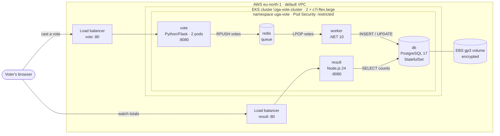
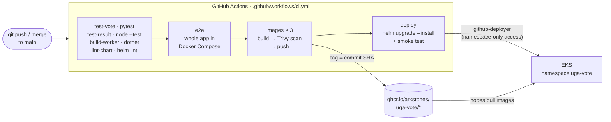
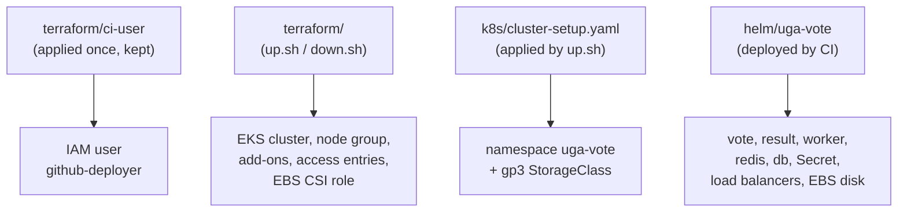

# Architecture

GitHub renders these diagrams directly (they are written in Mermaid).

## 1. The running system

- **vote** and **result** are the only public parts, each behind its own AWS load balancer.
- **Redis** decouples voting from saving. If the worker or database is down, votes wait in the queue instead of being lost (the rollback demo shows this).
- **Postgres** keeps its data on an EBS disk, so votes survive the pod restarting or moving.
- Every pod runs as a non-root user, with no Linux capabilities and no privilege escalation. The three app services also have read-only root filesystems.

## 2. From a push to a running release

- Pull requests run everything except pushing images and deploying.
- Trivy fails the run on fixable CRITICAL or HIGH vulnerabilities.
- The deploy job is skipped (not failed) when the cluster has been destroyed to save money.

## 3. What creates what

